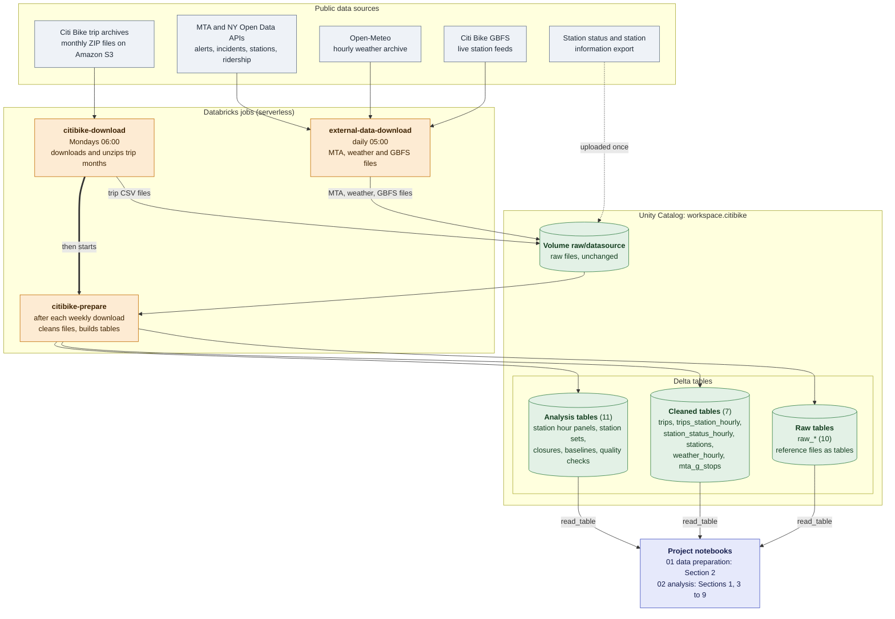

# Citi Bike demand during G train disruptions

DATA 622 final project. It studies how Citi Bike trips and station availability near Greenpoint change when
the G train is suspended, compared with normal weekends, using Citi Bike trip history, historical station status,
hourly weather and MTA service data. The work is in two notebooks, read in order:

1. [`notebooks/analysis/01_data_preparation.ipynb`](notebooks/analysis/01_data_preparation.ipynb): Section 2, the Databricks
   jobs, the cleaning rules, the tables in the catalog, the data sources and the checks behind every analysis table.
2. [`notebooks/analysis/02_citibike_demand_analysis.ipynb`](notebooks/analysis/02_citibike_demand_analysis.ipynb): the
   research question, exploration, models, evaluation and findings (Sections 1 and 3 to 9). It reads the prepared tables
   and runs on its own.

All data lives in Databricks: raw files in a Unity Catalog volume, cleaned and analysis tables as Delta tables.

## Repository structure

```text
databricks.yml        Databricks Asset Bundle: variables (catalog, schema, volume), targets, includes resources/
resources/            job definitions (one file per job)
jobs/                 Databricks notebooks the jobs run: downloads and data preparation
src/citibike/         shared Python package
  config.py             catalog, schema, volume and table names in one place
  data_access.py        Spark session (Databricks or Databricks Connect) and table readers
  notebook.py           notebook setup: connect() returns the configuration, Spark session and read_table
  study.py              study definitions: screening area, closure notices, periods, thresholds
  transformations.py    pandas functions that build the analysis tables
notebooks/
  analysis/             01_data_preparation (Section 2) and 02_citibike_demand_analysis (Sections 1, 3 to 9)
  archive/              earlier versions that read a local datasource/ folder, kept unchanged for reference
  proposal/             the project proposal notebook (Google Colab)
docs/                 data source documentation and the proposal PDF
tests/                pytest tests for src/citibike
pyproject.toml        package metadata, dependencies and pytest settings
```

## Databricks architecture



| Layer | Tables |
|---|---|
| Raw reference files | `raw_station_info`, `raw_mta_subway_stations`, `raw_mta_subway_alerts_2026`, `raw_mta_g_alerts_2012_2020`, `raw_mta_g_delay_incidents_monthly`, `raw_mta_g_station_hourly_ridership_2026`, `raw_mta_live_alerts_snapshot`, `raw_greenpoint_station_weather_lookup`, `raw_greenpoint_weather_hourly_2026`, `raw_greenpoint_weather_hourly_extended` |
| Cleaned | `trips`, `trips_ingest_log`, `trips_station_hourly`, `station_status_hourly`, `stations`, `weather_hourly`, `mta_g_stops` |
| Analysis | `analysis_station_hour_panel_extended` (main modeling table), `analysis_station_hour_panel`, `model_station_sets`, `greenpoint_station_exposure`, `mta_subway_shutdowns`, `g_service_closures_confirmed`, `g_service_closures_confirmed_pre_august`, `g_service_reduction_windows_inferred`, `baseline_accuracy_by_month`, `shutdown_effect_screening`, `trip_hourly_model_stations`, `greenpoint_station_g_stop_distances`, `mta_g_service_events`, `shutdown_events`, `model_station_g_stop_distances`, `status_proxy_check`, `data_quality_checks` |

[`docs/data_sources.md`](docs/data_sources.md) maps every raw file to its tables and records where each source comes from.

## Data source configuration

Catalog, schema and volume are set once:

* for jobs, by the bundle variables `catalog`, `schema`, `volume` in `databricks.yml` (passed as job parameters);
* for notebooks, by the `catalog`, `schema`, `volume` widgets in Databricks, or the environment variables
  `CITIBIKE_CATALOG`, `CITIBIKE_SCHEMA`, `CITIBIKE_VOLUME` elsewhere. The defaults are `workspace`, `citibike`, `raw`.

Code reads tables by name through `citibike.data_access`, never by path:

```python
from citibike import data_access

panel = data_access.read_pandas("analysis_station_hour_panel_extended", where="station_active")
trips = data_access.read_table("trips")   # Spark DataFrame: filter and aggregate before converting to pandas
```

`read_pandas` stops with an error if a query would return more than 3 million rows, so a missing filter cannot
download a whole table by accident.

## Connect from VS Code

1. Install the [Databricks extension](https://marketplace.visualstudio.com/items?itemName=databricks.databricks) and the
   [Databricks CLI](https://docs.databricks.com/dev-tools/cli/install.html) (on Windows: `winget install Databricks.DatabricksCLI`).
2. Log in once: `databricks auth login --host https://<your-workspace>.cloud.databricks.com --profile dev`.
   Credentials stay in `~/.databrickscfg` and the CLI token cache, never in this repository. The bundle targets use the
   `dev` profile; if you name yours differently, change `profile` in `databricks.yml` or set `DATABRICKS_CONFIG_PROFILE`.
3. Create the environment with **Python 3.12** (Databricks Connect does not support Python 3.13 yet) and install the project:

   ```bash
   py -3.12 -m venv .venv                      # macOS/Linux: python3.12 -m venv .venv
   .venv\Scripts\activate                      # macOS/Linux: source .venv/bin/activate
   pip install -e ".[local,analysis,dev]"
   ```

4. In the Databricks sidebar choose the `dev` target, and select `.venv` as the notebook kernel.

### Running notebooks in Databricks and locally

* **In Databricks** (open the notebook from your Git folder or the deployed bundle): the notebook uses the cluster's own
  Spark session and `dbutils` widgets. Run it on serverless compute.
* **In VS Code**: Spark queries run on serverless compute in the workspace through Databricks Connect, and pandas, plots and
  models run on your machine. Only the rows a query returns are downloaded (the extended panel is about 1.5 million rows).
  Widgets are not available, so set `CITIBIKE_*` environment variables to change the schema. `databricks` must be on
  `PATH` because the login profile uses the CLI to get tokens.

The first cell of every notebook adds `src/` to the Python path by walking up to the folder that contains
`databricks.yml`, so the package works in both places without installing it in Databricks.

## Run the jobs

```bash
databricks bundle validate                     # check the configuration (dev target)
databricks bundle validate -t prod
databricks bundle deploy                       # dev: job names get a "[dev <you>]" prefix, schedules paused
databricks bundle run citibike_prepare         # rebuild the tables (only new or changed trip months are reloaded)
databricks bundle run citibike_prepare --params full_refresh=true
databricks bundle deploy -t prod               # prod: schedules active
```

`citibike_prepare` also accepts `target_schema=<schema>` to write the tables to another schema of the same catalog,
which is how changes to the preparation code can be checked without touching the real tables.

## Run the tests

```bash
pytest
```

The tests cover `src/citibike` (configuration, the data access guard rails with a fake Spark session, and the study
transformations on small synthetic data). They do not need a Databricks connection.

## Notes

* `notebooks/archive/` holds the earlier versions of the analysis that read a local `datasource/` folder relative to the
  working directory. They are kept as they were submitted and are not maintained.
* The study periods are fixed in `src/citibike/study.py` (May to September 2024 and January to September 2026). New trip
  months are added to `trips` and `trips_station_hourly` automatically but not to the analysis panels.
